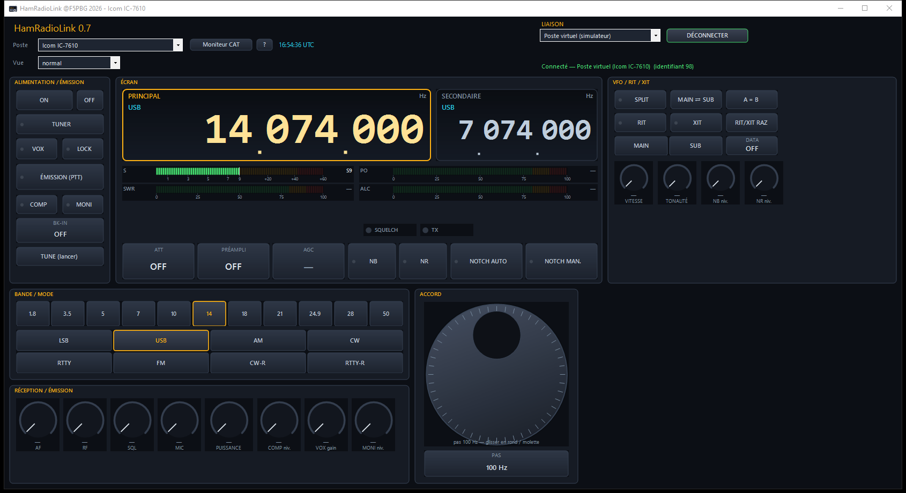
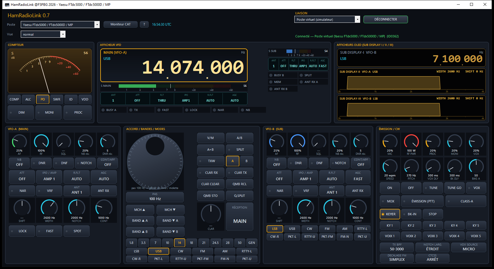
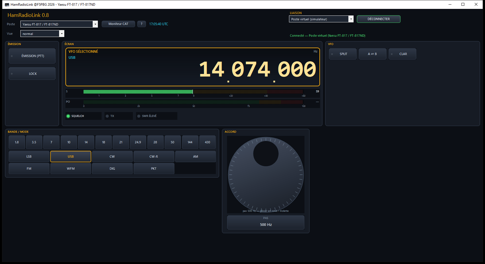

# HamRadioLink — par F5PBG, 2026

*[English version below](#english)*

**HamRadioLink** est une télécommande Windows pour postes radio : elle reproduit la **face avant** du poste à l'écran et le pilote par **CAT** (Yaesu, Kenwood, Elecraft) ou **CI-V** (Icom, Xiegu), comme si vous étiez devant. Logiciel **portable** : un seul `HamRadioLink.exe`, aucune installation, aucune bibliothèque tierce.







*Captures réalisées avec le poste virtuel intégré (simulateur).*

## Postes pris en charge (125 ; la liste déroulante est triée par ordre alphabétique)

| Marque | Postes |
|---|---|
| **Yaesu** (CAT ASCII) | FT-2000, FTdx5000 (face avant complète), FTdx10, FT-450D, FT-710, FT-891, FT-950, FT-991A, FTdx101D/MP, FTdx3000, FTdx1200, FTdx9000, FTX-1 |
| **Yaesu** (anciens protocoles à bloc d'état, d'après Hamlib) | FT-100, FT-600, FT-736R, FT-747GX, FT-757GX / GXII, FT-767GX, FT-840, FT-890, FT-900, FT-920, FT-990, FT-1000 / D / MP / Mark-V / Mark-V Field — fréquence, mode, PTT seulement, **sans manuel CAT : à vérifier** (FT-736R et FT-757GX : le poste ne renvoie rien) |
| **Yaesu** (binaire 5 octets) | FT-817 / 818, FT-857, FT-897, FT-847, FT-650 — jeu de commandes de base (fréquence, mode, PTT, split, CLAR, A/B, S-mètre, puissance), **sans manuel CAT : à vérifier** |
| **Icom** (CI-V, 55 postes) | IC-7000, 7100, 7200, 7300, 7300MK2, 7400, 7410, 7600, 7610, 7700, 7760, 7800, 7850, 7851, 705, 905, 9100, 9700, 756 / PRO / PROII / PROIII, 746 / PRO, 718, 78, 703, 706 / MKII / MKIIG, 707, 736, 737, 738, 775, 820H, 821H, 910H, 970, 725, 726, 728, 729, 735, 751/A, 761, 765, 781, 271, 275, 375, 471, 475, 575, 1275 |
| **Xiegu** (CI-V) | G90, X108G, X5105, X6100, X6200 |
| **Kenwood** | TS-480, TS-890, TS-590S/SG, TS-990S, TS-2000, TS-B2000, TS-870S, TS-570, TS-850S, TS-50S, TS-60S, TS-450S, TS-690S, TS-790, TS-930S, TS-940S, TS-950S/SDX, TS-440S, TS-140S, TS-680S, TS-711, TS-811 |
| **Elecraft** | K4, K3 / K3S, KX3, KX2, K2 |

## Fonctions

**Face avant et réglages**
- **Face avant fidèle** : afficheurs de fréquence (clic sur un chiffre, molette, saisie), vumètres (barres ↔ aiguille par clic droit), boutons, potentiomètres, molette d'accord, bandes et modes, deux récepteurs quand le poste en a deux.
- **Config vue** : tout se déplace et se redimensionne à la souris ; **Valider**, **Retour arrière** (illimité) et **Réinit**. **Clic droit sur un élément** : la commande CAT / CI-V est visible et **modifiable** (test de lecture, bouton « Défaut »). **Ajouter** crée un élément à partir des commandes **du poste choisi**.
- **Paramètres ⚙** : couleurs de l'interface (dont fond des touches actives, voile des verrous, bouton de connexion vert / rouge), niveau du voile, molette, vumètres, **réinitialisation de tous les verrous**, **journal des commandes**, commande manuelle. **Export / import ⇅** des réglages, dispositions et réglages du poste.
- **Export / import ⇅ par parties** : logiciel et dispositions, réglages du poste, menu interne du poste (6 Yaesu) ; **commandes de nombreux postes contrôlées contre les manuels CAT officiels** (Yaesu, Kenwood, Icom).
- **Verrous** par clic droit sur n'importe quel organe (une seule touche d'une rangée de modes / bandes) et **touche Lock** qui bloque tout le programme.
- **Touche PTT** verte au repos, rouge en émission ; **clic droit = délai de sécurité TX** (jusqu'à 30 min, compte à rebours, coupure automatique) ; **micro du PC vers le poste** : le même menu envoie le micro choisi sur la carte son reliée au poste (aussi dans Paramètres ⚙).
- **Journal de trafic (bouton LOG, 1.0)** : base MariaDB au choix ou intégrée, import ADIF / partage d'une base existante, **QSO de WSJT-X reçus automatiquement** (ports réglables dans Paramètres ⚙), distance calculée à chaque contact, **DX Cluster** (échelle de la bande avec curseurs VFO A / B, clic sur un indicatif = le poste se règle, alertes sonores), **28 thèmes** aux couleurs personnalisables. Gardez une sauvegarde ADIF.
- **Moniteur CAT** et **journal des commandes** (un fichier par jour, purgé, envoyable pour diagnostiquer).
- **IC-7760** : fenêtre complète reprise d'[IC7760Link](https://github.com/F5pbgLudovic/IC7760Link).

**Liaisons (accès complet seulement)**
- **Port COM** (CAT / CI-V direct), **CAT sur TCP**, **poste virtuel** (simulateur strict) et **TCI** (ExpertSDR3 / SunSDR, Thetis : « Poste commandé en TCI »). Hamlib, OmniRig et FLRig (jeu de commandes réduit) ne sont volontairement pas proposés.
- **Plusieurs postes en même temps** : une coche par poste ouvert (fond vert = connecté, vert vif = sélectionné), affichage scindé côte à côte ou l'un sous l'autre, **connexion automatique** par clic droit sur CONNECTER, boutons de postes mémorisés avec leurs réglages de liaison (clic droit = retirer).
- **Partage du poste** (bouton *Partage*, réglé **poste par poste**) : port COM virtuel (paire **com0com**, installée / créée / supprimée au besoin, états des paires affichés) et / ou serveur TCP pour qu'OmniRig, un logiciel de log ou WSJT-X pilotent le même poste en même temps, sans filtre.
- **Serveur de commande IP** (bouton *Serveur*, port 7809, un second serveur possible pour un second poste) : WSJT-X, JTDX, JS8Call, SDRLink… pilotent le poste choisi, quel que soit son modèle (fréquence A / B, mode, PTT, split, volume).

**Postes** : liste triée par ordre alphabétique (125), dont les anciens Yaesu à protocole binaire (d'après Hamlib, sans manuel vérifié).

- **Autotest** (`--selftest`) : plus de 159 000 vérifications sur le simulateur, dont une liaison CI-V testée octet par octet, le partage, le serveur de commande et TCI.

## Télécharger

**[Télécharger la dernière version](https://github.com/F5pbgLudovic/HamRadioLink/releases/latest)** (`HamRadioLink-X.Y.zip`). Extrayez le zip dans un dossier puis lancez `HamRadioLink.exe`. Les réglages sont mémorisés dans le dossier `data` à côté de l'exe.

## Mise en route

1. **Sans poste** : menu *Poste* → votre modèle ; *Liaison* → « Poste virtuel (simulateur) » → **CONNECTER**.
2. **Avec le poste** : branchez le câble CAT / USB, choisissez *Port COM*, la vitesse réglée dans le poste, puis **CONNECTER**. Pour un Icom, vérifiez l'adresse CI-V (case « Adresse CI-V »).

Le mode d'emploi complet est dans **[AIDE.md](AIDE.md)** (English: **[HELP.md](HELP.md)**) ; les détails techniques et la vérification dans **[LISEZMOI.md](LISEZMOI.md)** ; la liste de toutes les commandes envoyées dans [doc/commandes-CAT.txt](doc/commandes-CAT.txt).

## État du projet — à lire

Tout a été développé et vérifié contre un **poste virtuel**. Des commandes du **FT-2000** et du **FTdx10** ont été essayées sur de vrais postes ; **le reste n'a jamais été essayé sur du matériel réel**.
- Pour les **8 Icom** dont le manuel CI-V est analysé (IC-7000, 7100, 7300, 7300MK2, 7410, 7610, 7760, 9700) et les Yaesu / Kenwood TS-480 / TS-890, chaque touche est contrôlée contre le catalogue du manuel.
- Pour **tous les autres postes**, la face avant et les commandes suivent la famille du modèle : **à vérifier sur le poste**. Tout se corrige par clic droit en config vue.
- **Testez l'émission sur charge fictive, à faible puissance.**

Les retours sont les bienvenus : ouvrez une [issue](https://github.com/F5pbgLudovic/HamRadioLink/issues) avec le modèle, la liaison et un extrait du Moniteur CAT.

## Compiler

```
powershell -ExecutionPolicy Bypass -File build.ps1
```

Utilise le compilateur .NET Framework 4 fourni avec Windows (C# 5) : rien à installer. Résultat dans `dist\HamRadioLink.exe` ; l'exe précédent est renommé `HamRadioLink-<version>.exe`.

## Licence

[GPL v3](LICENSE). Projet indépendant, **non affilié** à Yaesu, Icom, Kenwood, Elecraft ni Xiegu ; ces noms sont des marques de leurs propriétaires. Voir [THIRD-PARTY-NOTICES.md](THIRD-PARTY-NOTICES.md).

73 de F5PBG

---

<a name="english"></a>
# HamRadioLink — by F5PBG, 2026

**HamRadioLink** is a Windows remote control for amateur radio transceivers. It draws the radio's **front panel** on screen and drives the rig over **CAT** (Yaesu, Kenwood, Elecraft) or **CI-V** (Icom, Xiegu). Portable: a single `HamRadioLink.exe`, no installer, no third-party library.

**Supported rigs (125, list sorted alphabetically)**: Yaesu FT-817/818/857/897/847/650 (5-byte binary protocol, basic command set); older Yaesu FT-100, FT-600, FT-736R, FT-747GX, FT-757GX/GXII, FT-767GX, FT-840/890/900/920, FT-990, FT-1000/D/MP/Mark-V (block-status protocols from Hamlib, frequency / mode / PTT only, no manual checked); Yaesu FT-2000, FTdx5000, FTdx10, FT-450D, FT-710, FT-891, FT-950, FT-991A, FTdx101D/MP, FTdx3000, FTdx1200, FTdx9000, FTX-1; **55 Icom** models (IC-7000 … IC-7851, IC-705/905/9700, IC-706, IC-746, IC-756, IC-775 and older 7xx series); Xiegu G90, X108G, X5105, X6100, X6200; **22 Kenwood** models (TS-480, TS-890, TS-590, TS-990, TS-2000 … TS-811); Elecraft K4, K3/K3S, KX3, KX2, K2. *Not yet:* other binary-protocol Yaesu radios (FT-847, FT-990/1000, FT-100…).

**Highlights**

*Front panel and settings*
- Faithful front panel per model (dual receivers, meters bar ↔ needle by right-click, knobs, tuning wheel).
- **Layout editor** ("config vue"): move and resize everything, Apply / Undo / Reset. **Right-click any control** to see and edit its CAT / CI-V command; **Add** builds new controls from the selected radio's own command catalogue.
- **Settings ⚙**: interface colours (active-key background, lock veil, green / red connection button), veil level, mouse wheel, meters, **reset of every lock**, **command log**, manual command. **Export / import ⇅** of settings, layouts and radio settings.
- **Export / import ⇅ by parts**: program and layouts, radio settings, radio internal menu (6 Yaesu); **many radios' commands checked against the official CAT manuals** (Yaesu, Kenwood, Icom).
- **Locks** by right-click on any control (a single key of a mode / band row) and a **Lock key** that blocks the whole program.
- **PTT key** green at rest, red when transmitting; **right-click = TX safety timeout** (up to 30 min, countdown, automatic cut); **PC microphone to the rig**: the same menu sends the chosen microphone to the sound card connected to the radio (also in Settings ⚙).
- **Traffic log (LOG button, 1.0)**: MariaDB database of your choice or embedded, ADIF import / sharing of an existing database, **QSOs from WSJT-X received automatically** (ports set in Settings ⚙), distance computed for every contact, **DX Cluster** (band scale with VFO A / B cursors, click a callsign to tune the radio, sound alerts), **28 themes** with customisable colours. Keep an ADIF backup.
- **CAT monitor** and a **command log** (one file per day, purged, can be sent to diagnose a problem).
- **IC-7760**: full window taken from [IC7760Link](https://github.com/F5pbgLudovic/IC7760Link).

*Links (full command access only)*
- **COM port** (direct CAT / CI-V), **CAT over TCP**, a strict **virtual radio** and **TCI** (ExpertSDR3 / SunSDR, Thetis: "Poste commandé en TCI"). Hamlib / OmniRig / FLRig (reduced command set) are deliberately not offered.
- **Several radios at once**: one tick per open radio (green background = connected, bright green = selected), split display side by side or stacked, **automatic connection** by right-clicking CONNECT, radio buttons remembered with their link settings (right-click = remove).
- **Radio sharing** (*Partage* button, set **radio by radio**): virtual COM port (**com0com** pair, installed / created / deleted on demand, pair states shown) and / or a TCP server, so OmniRig, a logger or WSJT-X can drive the same radio at the same time, unfiltered.
- **IP command server** (*Serveur* button, port 7809, a second server for a second radio): WSJT-X, JTDX, JS8Call, SDRLink… drive the selected radio whatever its model (VFO A / B frequency, mode, PTT, split, volume).

**Rigs**: list sorted alphabetically (125), including the older binary-protocol Yaesu models (from Hamlib, no manual checked).

Built-in self-test (`--selftest`): more than 159,000 checks against the simulator, including a byte-by-byte CI-V link, sharing, the command server and TCI.

**Download**: [latest release](https://github.com/F5pbgLudovic/HamRadioLink/releases/latest), extract and run `HamRadioLink.exe`. User guide: [HELP.md](HELP.md) (English), [AIDE.md](AIDE.md) (French).

**Status**: everything was developed and tested against a virtual radio; only some FT-2000 / FTdx10 commands were tried on real rigs. Command sets are checked against the manuals for the Icom IC-7000/7100/7300/7300MK2/7410/7610/7760/9700, Yaesu and Kenwood TS-480/TS-890; all other models follow their family and **need checking on the real radio**. Test transmit on a dummy load at low power. Feedback welcome via [issues](https://github.com/F5pbgLudovic/HamRadioLink/issues).

**Build**: `powershell -ExecutionPolicy Bypass -File build.ps1` (uses the .NET Framework compiler shipped with Windows).

Licence: GPL v3. Independent project, not affiliated with Yaesu, Icom, Kenwood, Elecraft or Xiegu.

73 de F5PBG
